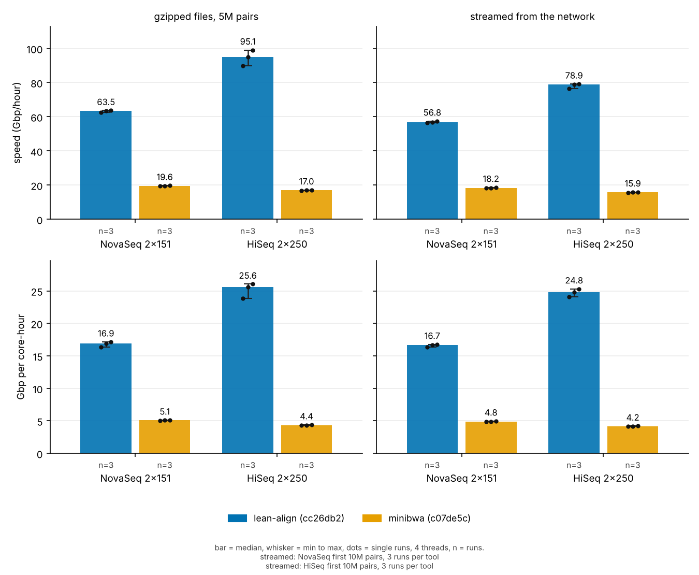

# Results for the README and blog: how every number and figure was made

lean-align f465a57 against minibwa c07de5c, 4 threads on 4 cores. Bar = median, whisker = min to max, dots = single runs, n = number of runs. Peak memory is in `figs/vs_minibwa_memory.png`. How it was made: the first section under "Per figure and table".

Everything here was made on 4-core boxes (4 threads, `taskset -c 0-3`) unless a row says otherwise. Data are in `data/`,
figures in `figs/` (`.svg` and `.png`), tables in `RESULTS.md`. Rerun with `python3 make_figs.py` and `python3 make_tables.py`
(matplotlib only). The scripts read `data/*.tsv` and skip NA rows; the table numbers are not hard-coded.
`lean-align-results.zip` holds `figs/`, `data/`, `RESULTS.md`, `README.md`, both scripts and `scripts/`.

## Files

| file | content |
|---|---|
| `data/reps.tsv` | one row per single run of lean-align f465a57 and minibwa: `gz5m` (5M pairs from gz), `stream` (NovaSeq first 10M pairs, same pipeline for both tools), `stream_single` (older single streamed runs). The data of `figs/vs_minibwa*` |
| `data/runs.tsv` | every timing run, with medians where there are repeats: 5M gz runs, streamed runs, whole lanes, before and after builds |
| `data/slow_jobs.tsv` | jobs longer than 5 s and idle cores, before and after |
| `data/slow_pairs.tsv` | the slowest single pairs, mapped alone on 1 core |
| `data/slow_pairs_stream.tsv` | the 36 slowest pairs of the HiSeq lane, before and after, same pair indexes |
| `data/ec2_compare.tsv` | real reads, 1M pairs each: mapped, unique and agreement with minibwa, lean-align f465a57 (from `Testing/ec2/compare.py`) |
| `data/accuracy.tsv`, `data/roc.tsv` | simulated-read accuracy (re-measured on f465a57) and the older 200k real-read numbers (027ef1e) |
| `data/paper_perf.tsv` | the minibwa paper's Fig. 3 numbers, as published |
| `scripts/` | `util/` stream harness and trace analysis, `stream/` scripts of the streamed minibwa/ours runs, `ec2/` timing and agreement scripts (also for 16/32 cores), `sim_pairs.py`, `roc_from_sams.py` |

## Box and common method

- Box: 4 cores (Intel Xeon @ 2.10 GHz, 1 thread per core), 15 GB RAM, Linux. This is the box of my own runs (the lane and trace
  runs). The other rows were made on other boxes, named in the `source` column (the gz5m_script / `ec2_check` rows: 4 vCPU Xeon 2.3 GHz,
  15 GB RAM); all rows are 4 threads on 4 cores. Everything runs on those 4 cores:
  the aligner, the decompressors and the output sink (`os.sched_setaffinity` / `taskset -c 0-3`). hg38, one index per tool.
- lean-align index: `lean-align build hg38.upper.fa ic.idx` (5,338,015,764 bytes, built once with the code under test; the
  format has not changed between the builds compared). minibwa c07de5c with its own index.
- Commits: `64ae73f` = before (jobs of 16000 pairs, 8 in flight); `351301d` = first slow-pair fix; `f465a57` = merged build
  (4000-pair jobs, 32 in flight, slow-pair fixes). `e96862d` = older build used in the 5M gz rows.
- Output: the new `Main` writes `OUT.tmp` and renames it, so `/dev/null` cannot be the output. The sink is a FIFO at `OUT.tmp`
  drained by `cat > /dev/null` (md5 sink where marked).
- Time (my lane and trace runs): `wall_s` = start to exit. `map_s` = wall minus the index load, measured inside the run (the load ends when the
  process has read as many bytes as the index file). `cpu_s` = user + system CPU of lean-align from the kernel (`wait4`),
  with the CPU used during the index load subtracted in the lane rows. Peak memory = `ru_maxrss` of lean-align (`wait4`).
- Rates: in the lane rows Gbp/hr = letters in both read files / map_s * 3600 and Gbp/core-hr = the same letters / cpu_s * 3600 (aligner
  CPU only). In the `gz5m_script` and `stream` rows the rates use the wall time including index load (and, for `gz5m_script`, CPU including both gzips).
  Exact letter counts: NovaSeq 40M pairs = 12.08 Gbp (all reads 151); HiSeq lane = 16.835 Gbp (33,916,091 pairs, counted
  with `awk` on the stream).
- Repetitions: stated per row in `runs.tsv` (`reps`). The lane runs are single runs. Run-to-run spread on this box is about 2 percent.

## Per figure and table

### vs_minibwa and vs_minibwa_memory: lean-align against minibwa, every single run (`figs/vs_minibwa`, `figs/vs_minibwa_memory`)
- The headline figure. Only current lean-align (f465a57) and minibwa (c07de5c), 4 threads on 4 cores, no "before" bars.
  Bar = median of the runs, whisker = min to max (none when n = 1), dots = single runs, n = number of runs under each bar.
  Rows: Gbp/hour and Gbp per core-hour; memory is a separate figure with the same layout.
- Data: `data/reps.tsv`, one row per single run. `make_figs.py` reads only this file for these two figures and uses all rows it
  finds, so new runs are added by appending rows (new `rep` numbers or sizes); nothing has to be edited in the script.
- Column "gzipped files, 5M pairs" (experiment `gz5m` in `data/reps.tsv`, 3 runs per tool and data set): the newest session, timing box, `Testing/ec2/bench.py`,
  4 threads, default pipes, the SAME output sink for all tools, one session with the 3 repetitions alternating between the builds and minibwa. Wall includes the
  index load. CPU is the aligner plus both `gzip -dc`. Peak memory = `ru_maxrss` of the aligner. `verify.sh` steps 1 to 5 passed on cc26db2. Reads: the first 5M
  pairs of each file (URLs under "How it got faster", (d)), recompressed to gz (NovaSeq 1.510 Gbp). The legend names the lean-align build(s) plotted in each column;
  lean-align is the new build (cc26db2) and minibwa is c07de5c. Rows are as given to me; I did not recompute them.
  HiSeq 5M (2.482 Gbp): the third cc26db2 repetition is slow (99.5 s against 90.2 and 93.9 s); the median is 7.5 percent faster than f465a57 (93.9 against 101.5 s) and the worst repetition only 2 percent faster (99.5 against 101.5 s).
  The rows were checked against `Testing/results/ec2_check/instr_all/timing_{nova5m,hiseq5m}.tsv` on festive (identical).
  The same session's lean-align f465a57 runs are in experiment `gz5m_prev_build` (used only by `figs/this_round`). The earlier `ec2_check` session
  (script version before `fix/ec2-scripts`: lean-align through a `cat` pipe, minibwa to /dev/null; Xeon 2.3 GHz VM) is kept as experiment `gz5m_old_session` and is not plotted.
- Column "streamed" (experiment `stream` in `data/reps.tsv`): NovaSeq, the first 10M pairs (3.020 Gbp) streamed from the network, 4 threads, newest session, made by S-P in
  ONE container (branch `bench/stream-results`, folders `Testing/results/stream/runs/n10000000_*_s_*`): lean-align cc26db2 x3 and minibwa c07de5c x3, with two lean-align f465a57
  reference runs of the same session (experiment `stream_prev_build`, used only by `figs/this_round`). Same pipeline for all runs: resuming downloader (`retrycat.py`),
  `gunzip`, output to `cat > /dev/null`, own index file cat-ed into the page cache before each run, runs alternating. Wall includes the index load; CPU is the aligner only
  (not the gunzip and downloader), so Gbp/core-hr of this column is not the same measure as in the gz column. This container was slower than the one of the night before
  (f465a57 204 to 211 s now against 171 to 178 s then), so compare within one session only. Rows are as given to me (not checked against `result.json`).
  Last night's NovaSeq repetitions (f465a57 and minibwa, first 10M pairs, a faster container) are kept as experiment `stream_old_session` and are not plotted.
- HiSeq in the streamed column: no repetitions yet. The bars show the older single runs of the whole GIAB lane (33,916,091 pairs; experiment
  `stream_single`: lean-align on the trace box, minibwa on the trim box, resuming downloader, md5 sink). The script plots the experiment `stream` for a
  data set when it has rows of it and `stream_single` otherwise, so HiSeq repetitions appended as `stream` rows replace the single runs.
  The older NovaSeq single runs (10M, 20M, 40M; other sinks and downloaders) stay in `reps.tsv` as `stream_single` and are not in this figure.
- HiSeq streamed repetitions (experiment `stream`, first 10M pairs, 4.9638 Gbp, 3 per tool, from S-P; `reps.tsv` rows as given to me, their `result.json` not yet checked): the container restarted between lean-align run 2 and minibwa run 2; after the restart both tools used 10 to 25 percent more CPU for the same work, so the HiSeq spread is mostly the restart, not run-to-run noise. The figure footnote says so. These rows are to be replaced by repetitions on the integrated build.
- A bar with n = 1 shows no error bar.

### (b) Peak memory (`figs/b_memory`)
- Left: the `gz5m_script` rows (5M pairs, same script for both tools, peak = `ru_maxrss` of the aligner).
- Right: streamed runs and whole lanes (`stream` and `lane` rows; lane rows first when both exist). lean-align lane rows: `ru_maxrss`
  from my runs. minibwa rows and the 20M and 40M lean-align rows: `result.json` of the per-run folders in `Testing/results/stream/`
  (rusage of the aligner from `wait4`). minibwa on the HiSeq lane: `trim box` row, same measure.
- lean-align uses 5.6 to 5.9 GB: the index is 5.3 GB. minibwa uses 8.5 to 8.8 GB.

### (c) Throughput vs run size and whole lanes (`figs/c_throughput_vs_size`)
- Left and middle: rows `stream` in `runs.tsv`: NovaSeq HG002, the first 10M, 20M and 40M pairs streamed from the network
  (`curl | gunzip`, no file on disk), 4 cores. Per-run files (`result.json`, `threads.csv`, logs) are in
  `Testing/results/stream/runs/` and the method is in `Testing/results/stream/README.md` (copied to `scripts/stream/`).
  lean-align output goes to a FIFO drained by `cat` (or `md5sum`); minibwa output goes to /dev/null.
- minibwa: 10M with plain `curl` (its wall time includes a cold index load of 158.9 s, marked `*` in the figure);
  20M and 40M with a resuming downloader (`scripts/stream/retrycat.py`), because plain `curl` dropped the stream under
  backpressure. Plain-curl attempts at 20M (14.26M pairs) and one earlier try ended short and are not used.
- "Before" is a `64ae73f`-era build (trace commit `f973b77`); the 10M and 20M rows are single runs.
- These are the older single streamed runs (`stream_single` in `reps.tsv`), kept for this run-size figure. Their pipelines differ from the repetition runs
  in `figs/vs_minibwa` (md5 or /dev/null sinks, plain `curl` or a resuming downloader, different boxes), so the 10M values here (lean-align 55.4 Gbp/hr) are not the
  same measurement as the 10M repetition runs (60.9 to 63.5 Gbp/hr).
- Right panel: whole lanes. HiSeq lane (33,916,091 pairs) and NovaSeq 40M pairs, before / after on my box (rows `lane`).
  minibwa on the HiSeq lane is the `trim box` row (resuming downloader, md5 sink, all on cores 0-3). minibwa on NovaSeq 40M is
  the 40M `stream` row (not a lane run). Rates use `map_s` where it exists and the wall time otherwise, so the minibwa NovaSeq
  bar includes its index load (see the `source` column of the row).
  Different boxes and downloaders were used for the lean-align and minibwa lane rows.

### (f) Accuracy and uniqueness against minibwa (`figs/f_accuracy`; tables "Real reads, 1M pairs", "Real reads, 200k pairs", "Simulated reads")
- Real reads, in the figure (left, middle): 1M pairs of each data set, lean-align f465a57 against minibwa c07de5c (the counts were reproduced unchanged on cc26db2, `Testing/results/ec2_check/instr_all/compare_*.txt`), from
  `Testing/ec2/compare.py` (run by `Testing/ec2/run.sh` on the timing box); numbers in `data/ec2_compare.tsv`. The compare output
  files are not in this folder; the numbers were given to me and I did not recompute them. "Mapped" = neither mate unmapped.
  "Unique" = our `XU:Z:unique` on both mates; minibwa = MAPQ 60 or more on both mates. "Same place" = same chromosome and strand and
  overlapping alignments (not the same start: we trim low-quality ends, minibwa soft-clips them). The percentages in the
  "same place" rows are my division of the two counts.
- Simulated reads, in the figure (right): `scripts/sim_pairs.py mason|low|high`, seed 1, 100k pairs each, from hg38. Re-measured on
  f465a57; every value is identical to the first measurement (027ef1e). A pair is correct if both mates start within 10 bp
  of the true start. Classes (unique / unknown / not proper) are our own tags (`XU`); pairs we do not place count as wrong for us.
- Older measurement, in `data/accuracy.tsv` and in RESULTS.md only: `Testing/notes/UNIQUE_VS_MINIBWA.md`, lean-align 027ef1e,
  first 200k pairs of the bench release's `novaseq_200k` and `hg002_200k` (HiSeq 2x250); a pair is proper if flag 0x2 is set on both
  mates. Its real-read block was not re-run on f465a57. The 1M-pair f465a57 numbers above replace it in the figure; the two
  agree within 0.5 points for the unique share.

### (g) ROC on simulated reads (`figs/g_roc`)
- `data/roc.tsv` (made by `scripts/roc_from_sams.py` from the SAMs of the simulated sets in (f)). Per read, not per pair.
  Correct = same chromosome and the mapped and true intervals overlap by at least 10 percent (the paper's rule).
  x = reads mapped / all reads; y = correct / mapped. minibwa: one point per MAPQ threshold (60, 59, ... 0).
  lean-align: two points (MAPQ 60 = unique, and all mapped reads).
- Simulator vs the paper: the paper used mason v2.0.9 with `--illumina-read-length 150 --illumina-prob-mismatch-scale 2.5`
  on GRCh38. Mason is not installed here. `sim_pairs.py` `mason` mode approximates those options (no variants; mismatch rate
  0.2/0.4/1.2 percent times 2.5 at start / 66 percent / end of the read; 1 bp indels at 0.005 percent per base; fragment
  N(300, 30)). `low` and `high` add haplotype variants (1 SNP per 1000 bp and 1 per 100 bp). They are our own models, not the paper's data.
- Re-measured on f465a57 with minibwa c07de5c; all 69 rows are identical to the first measurement (027ef1e).

### (h) The paper's Fig. 3, WGS bars (`figs/h_paper_fig3_wgs`)
- `data/paper_perf.tsv`: `perf.tsv` of lh3/minibwa at c07de5c, WGS (HG002 NovaSeq 30x), 32 threads, two Xeon Gold 6130, as published.
- lean-align at 32 threads is not measured. The dashed slot is empty on purpose. A 16/32-core test is prepared in `scripts/ec2/`
  (`setup.sh`, `run.sh`; AWS c7a.8xlarge; its README explains the method and the differences from the paper).
- The 4-thread numbers in (a) to (c) are not comparable to the paper's 32-thread bars.

## How it got faster (before and after)

The figures that compare lean-align builds with each other: (a) 5M pairs, (d) slow jobs and (e2) slow pairs inside the lane run, (e) slow pairs alone.

### this_round: new build against the previous build, same session (`figs/this_round`, table "This round")
- Percent change of cc26db2 against f465a57 for wall time and CPU (medians of the 3 alternating runs of the same session, 5M gz pairs, 4 threads;
  experiments `gz5m` and `gz5m_prev_build`) and for instructions (callgrind, first 50k pairs, 1 thread, `MapFast.job`; the percentages come from the lead,
  `data/this_round.tsv`, the absolute counts were not given to me). Negative is better.

### (a) Speed at 4 threads, 5M pairs (`figs/a_speed_4threads`, table "Speed at 4 threads")
- Two methods, in two columns of the figure. Do not compare a bar of one column with a bar of the other.
- Column A, before and after (rows `gz5m`, `lean-align-before` e96862d and `lean-align` f465a57): map time with the index load
  excluded; 3-run median; both read files fed through `zcat` FIFOs; output discarded. Method: `Testing/notes/BENCH_SETUP.md`
  section 5 (branch `notes/bench-setup`). Timing box; I did not run these and did not re-check them against logs.
- Column B, lean-align against minibwa (rows `gz5m_script`, f465a57 and c07de5c): the same script for both tools,
  `Testing/ec2/run.sh` (`bench.py`), 4 threads, 3-run median (the single runs are in `data/reps.tsv`). Wall time includes the index
  load. CPU includes both `gzip -dc`. Everything is pinned to the same 4 cores. Output: these runs used the script version before
  `fix/ec2-scripts` (ccc7cd9): lean-align writes to a pipe drained by `cat`, minibwa to /dev/null; later versions use the same sink for both
  (`cat`'s CPU is not counted). Peak memory = `ru_maxrss` of the aligner. Gbp/hr = letters / wall; Gbp/core-hr = letters / CPU. Timing box.
- Reads: the first 5M pairs of each file (URLs under (d)), recompressed to gz.
- The earlier minibwa `gz5m` rows (`TO RE-MEASURE`, wall time only) are deleted: column B replaces them and nothing else used them.

### (d) Slow jobs (`figs/d_slow_jobs`, table "Slow jobs"), (e2) slow pairs inside the lane (`figs/e2_slow_pairs_in_lane`)
- My runs, trace box (this 4-core box). One run each per cell.
- Data (streamed, nothing on disk). HiSeq: GIAB HG002 2x250, lane D1_S1_L001, the whole lane (33,916,091 pairs):

      A=https://giab.s3.amazonaws.com/data/AshkenazimTrio/HG002_NA24385_son/NIST_Illumina_2x250bps/reads/D1_S1_L001
      ${A}_R1_001.fastq.gz  ${A}_R2_001.fastq.gz

  NovaSeq: the first 40M pairs of the HG002 30x PCR-free set used by the minibwa paper:

      G=https://storage.googleapis.com/brain-genomics-public/research/sequencing/fastq/novaseq/wgs_pcr_free/30x/HG002.novaseq.pcr-free.30x
      $G.R1.fastq.gz  $G.R2.fastq.gz

- Command (script `scripts/util/gzstream.py`, also on branch `exp/util-scripts`):

      NLINES=160000000 python3 gzstream.py LABEL BINARY URL_R1 URL_R2 new fifo      # NLINES = 4 x pairs; the lane ends by itself

  It starts `curl | gunzip -c | head -n NLINES > FIFO` per mate, the aligner, and a `cat` sink, all on cores 0-3.
- "Before" = `64ae73f` plus the trace commits `f973b77` (job and collect timestamps) and `d94d683` (every pair slower than 20 ms)
  from branch `exp/hol-trace`. "After" = `f465a57` with the same two trace commits and `94c6833` (stage lines) cherry-picked, as a local build (not pushed).
  The untraced `f465a57` NovaSeq run (771.7 s) is within 2 percent of the traced one (756.8 s), so the trace costs nothing measurable.
- Analysis: `scripts/util/slow.py TRACE 5` (jobs over 5 s, time with fewer than 4 jobs running), `scripts/util/pairs.py TRACE 1000`
  (pairs over 1 s; `PJ=4000` for the 4000-pair runs). "Ideal wall" = (aligner CPU + gunzip/curl CPU + sink CPU) / 4.
  `core_use_pipeline` = that same CPU / (map time * 4).
- Pair numbers are the same in both builds (job index * pairs per job + position in the job). Pair 2,538,239 of the lane is the
  `slow1` pair on branch `bench/slow-pairs`.
- The pair classes in `slow_pairs_stream.tsv` come from the trimmed mates: one letter repeated 20 or more times, or at most
  24 different 4-letter words, or a period of 8 or less matching in 90 percent of positions. Three pairs of the 36 matched none
  (35/35, 43/38 and 40/40 letters after trimming).
- Two untraced NovaSeq attempts failed because the network reset one mate's download (`curl: (56)`); the third is the one in
  the table. When one mate's stream stops early, lean-align keeps buffering the other mate (peak 9 to 14 GB, OOM kill once).

### (e) Slow pairs alone on one core (`figs/e_slow_pairs`)
- `slow_pairs.tsv`: single pairs (and 10 NovaSeq pairs together) mapped alone with the index loaded, 1 core, map seconds.
  Pairs: `bench/slow-pairs` branch (`Testing/notes/slow_pairs/`). Builds 64ae73f, 351301d, f465a57. From the timing box; not rechecked.
  The SAM output of the pairs is identical in the three builds (as reported when the rows were made).

## What changed since the first version of this folder

- HiSeq streamed, newest session (S-P, one container 09:46 to 11:15 UTC, first 10M pairs, 4.964 Gbp; experiments `stream` = cc26db2 and minibwa, `stream_prev_build` = f465a57 x2,
  `stream_old_session` = last night's HiSeq reps): **the new build shows no gain separable from noise in this series.** The two f465a57 reference runs are 237.3 and 213.0 s (11 percent apart),
  the cc26db2 runs 225.7 to 233.3 s; means: wall +1.5 percent, CPU +0.0 percent. Do not read a HiSeq streamed speed-up from `figs/this_round` or the table. **A/B PENDING:** a clean
  alternating A/B (6 runs each) is running; this paragraph is to be replaced with its result.
- Newest (this round): `gz5m` is now the newest session (cc26db2 and minibwa, same sink for all tools); the older `ec2_check` rows are `gz5m_old_session` (not plotted);
  the same session's f465a57 rows are `gz5m_prev_build`; new figure `figs/this_round`; the vs_minibwa legend names the plotted lean-align build(s) from the data.
- Before that (results-4): the streamed NovaSeq bars of `figs/vs_minibwa` and `figs/vs_minibwa_memory` use only the same-method repetition runs (`stream`, first 10M pairs, 3 per tool);
  the older single streamed runs moved to `stream_single`. HiSeq still shows the single lane runs.
- Before that: the headline figure `figs/vs_minibwa` and `figs/vs_minibwa_memory` (lean-align against minibwa only, every single run,
  from the new `data/reps.tsv`) is the first figure in this README and in RESULTS.md. The before/after figures (a, d, e, e2) moved
  under "How it got faster". The "Box" line for the gz5m_script rows is the ec2_check box (Xeon 2.3 GHz), see above.

- Figures (a) and (b): the ours-against-minibwa bars now use the `gz5m_script` rows (same script for both tools); the before/after
  bars keep the `gz5m` rows. The old minibwa `gz5m` rows are deleted.
- Figure (c): minibwa points for 10M, 20M and 40M, and a lane panel (HiSeq lane and NovaSeq 40M, before / after / minibwa).
- Figure (f): real-read bars now use the 1M-pair f465a57 comparison (`data/ec2_compare.tsv`); the legend names f465a57.
  The 200k table stays in RESULTS.md as the older measurement.
- Scripts: `scripts/ec2/` is refreshed from `Testing/ec2/` on festive (same output sink for both tools, medians, agreement rates);
  `scripts/stream/` is new (the streamed-run scripts of `Testing/results/stream/`).
- From the first version, still true: lane rows of `runs.tsv` (my runs) have `wall_s` = whole-run wall and `map_s` = map seconds,
  `cpu_s` = map-phase CPU of lean-align, 33,916,091 pairs for the HiSeq lane, and `Gbp_hr` / `Gbp_core_hr` from exact letter counts;
  `slow_jobs.tsv` matches my logs. Rows I did not run (`gz5m`, `gz5m_script`, `stream`, the minibwa lane row, `slow_pairs.tsv`,
  `ec2_compare.tsv`) are as given to me and not re-checked.

## Not measured, or older than f465a57

- lean-align at 16 and 32 threads; any run with more than 4 cores. The 4-thread numbers are not comparable to the paper's 32-thread bars.
- Streamed bars of `figs/vs_minibwa`: NovaSeq has 3 runs per tool (first 10M pairs); HiSeq has 1 run per tool (older single lane runs) until the HiSeq 10M repetitions are appended to `data/reps.tsv`. Streamed runs of other sizes and the lanes have no repetitions.
- minibwa on NovaSeq has no lane run of its own: the 40M row of the streamed runs stands in (different box and downloader).
- The streamed "before" rows and the 5M "before" rows use `64ae73f`- and `e96862d`-era builds.
- Real-read accuracy on f465a57 is 1M pairs per data set; the 200k real-read numbers are from 027ef1e.
- The compare output files behind `ec2_compare.tsv` and the per-run files of the lane rows other than the streamed ones are not in this folder.
