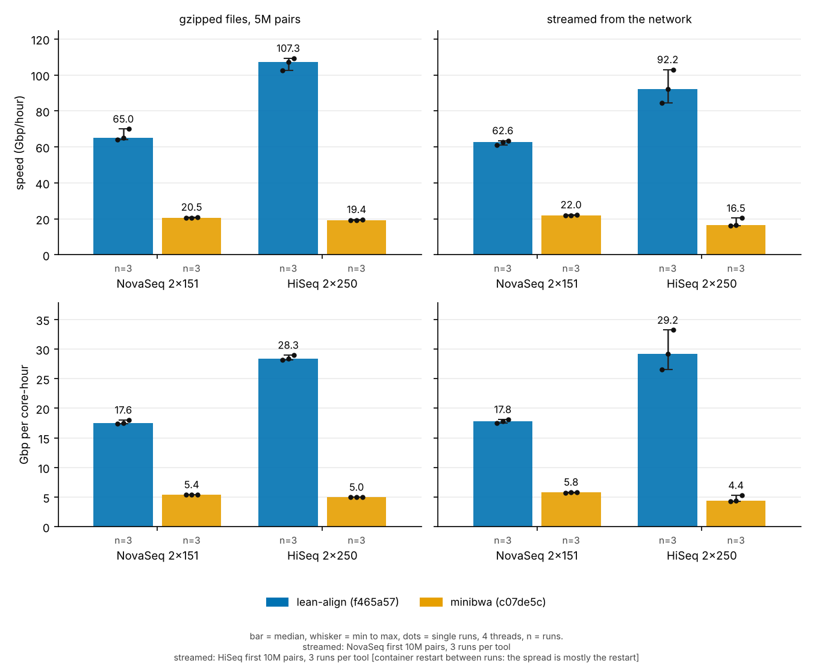
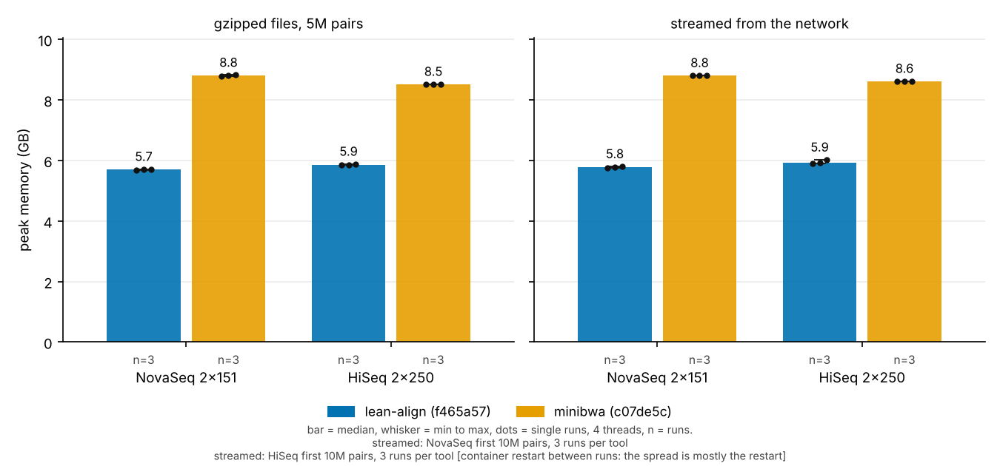

# Results (generated by make_tables.py from data/*.tsv; n/m = not measured yet)

Box: 4 cores (Intel Xeon 2.10 GHz, 1 thread per core), 15 GB RAM, hg38. Details: README.md.

# lean-align against minibwa

Bar = median, whisker = min to max, dots = single runs, 4 threads, n = number of runs (see the tables below).

## lean-align against minibwa: medians

The headline comparison (figs/vs_minibwa.svg). Median of the runs, with min to max in brackets; n = number of runs. Four threads on four cores, lean-align f465a57 against minibwa c07de5c. gz5m = 5M pairs from gz files; stream = the first 10M NovaSeq pairs streamed from the network, same pipeline for both tools, 3 runs each; stream_single = older single streamed runs (other sizes, and the HiSeq lane, which figs/vs_minibwa plots for HiSeq until HiSeq repetitions exist).

| experiment | data | tool | n | Gbp/hr | Gbp/core-hr | peak GB |
|---|---|---|---|---|---|---|
| gz5m | hiseq_2x250 | lean-align | 3 | 107.3 (102.6 to 109.3) | 28.3 (28.1 to 29.0) | 5.9 (5.8 to 5.9) |
| gz5m | hiseq_2x250 | minibwa | 3 | 19.4 (19.3 to 19.7) | 5.0 (5.0 to 5.0) | 8.5 (8.5 to 8.5) |
| gz5m | novaseq_2x151 | lean-align | 3 | 65.0 (64.0 to 70.0) | 17.6 (17.4 to 18.0) | 5.7 (5.7 to 5.7) |
| gz5m | novaseq_2x151 | minibwa | 3 | 20.5 (20.4 to 21.0) | 5.4 (5.4 to 5.4) | 8.8 (8.8 to 8.8) |
| stream | hiseq_2x250 | lean-align | 3 | 92.2 (84.5 to 103.0) | 29.2 (26.6 to 33.2) | 5.9 (5.9 to 6.0) |
| stream | hiseq_2x250 | minibwa | 3 | 16.5 (16.1 to 20.4) | 4.4 (4.3 to 5.3) | 8.6 (8.6 to 8.6) |
| stream | novaseq_2x151 | lean-align | 3 | 62.6 (60.9 to 63.5) | 17.8 (17.5 to 18.1) | 5.8 (5.8 to 5.8) |
| stream | novaseq_2x151 | minibwa | 3 | 22.0 (21.8 to 22.3) | 5.8 (5.7 to 5.9) | 8.8 (8.8 to 8.8) |
| stream_single | hiseq_2x250 | lean-align | 1 | 88.7 | 26.3 | 5.9 |
| stream_single | hiseq_2x250 | minibwa | 1 | 17.3 | 4.5 | 8.6 |
| stream_single | novaseq_2x151 | lean-align | 3 | 55.9 (55.4 to 55.9) | 16.1 (16.1 to 16.1) | 5.7 (5.7 to 5.7) |
| stream_single | novaseq_2x151 | minibwa | 2 | 19.9 (19.8 to 20.0) | 5.2 (5.2 to 5.3) | 8.8 (8.8 to 8.8) |

## lean-align against minibwa: every single run

One row per run, as in data/reps.tsv. The older minibwa NovaSeq 10M single run is not here because its wall time includes a cold index load of 158.9 s (it is in the streamed table below). CPU of the stream rows is the aligner only; for gz5m it includes both gzips.

| experiment | data | pairs | tool | commit | run | wall s | CPU s | peak GB | Gbp/hr | Gbp/core-hr |
|---|---|---|---|---|---|---|---|---|---|---|
| gz5m | novaseq_2x151 | 5000000 | lean-align | f465a57 | 1 | 85.0 | 309.7 | 5.71 | 63.97 | 17.55 |
| gz5m | novaseq_2x151 | 5000000 | lean-align | f465a57 | 2 | 77.7 | 301.4 | 5.71 | 69.99 | 18.03 |
| gz5m | novaseq_2x151 | 5000000 | lean-align | f465a57 | 3 | 83.6 | 312.0 | 5.67 | 65.02 | 17.42 |
| gz5m | novaseq_2x151 | 5000000 | minibwa | c07de5c | 1 | 259.0 | 1001.5 | 8.82 | 20.99 | 5.43 |
| gz5m | novaseq_2x151 | 5000000 | minibwa | c07de5c | 2 | 266.5 | 1012.5 | 8.79 | 20.39 | 5.37 |
| gz5m | novaseq_2x151 | 5000000 | minibwa | c07de5c | 3 | 264.7 | 1010.7 | 8.80 | 20.53 | 5.38 |
| gz5m | hiseq_2x250 | 5000000 | lean-align | f465a57 | 1 | 87.1 | 317.6 | 5.85 | 102.57 | 28.14 |
| gz5m | hiseq_2x250 | 5000000 | lean-align | f465a57 | 2 | 83.2 | 315.3 | 5.86 | 107.35 | 28.34 |
| gz5m | hiseq_2x250 | 5000000 | lean-align | f465a57 | 3 | 81.7 | 308.3 | 5.88 | 109.32 | 28.99 |
| gz5m | hiseq_2x250 | 5000000 | minibwa | c07de5c | 1 | 454.0 | 1784.6 | 8.51 | 19.69 | 5.01 |
| gz5m | hiseq_2x250 | 5000000 | minibwa | c07de5c | 2 | 462.7 | 1806.1 | 8.51 | 19.31 | 4.95 |
| gz5m | hiseq_2x250 | 5000000 | minibwa | c07de5c | 3 | 461.7 | 1806.6 | 8.52 | 19.36 | 4.95 |
| stream_single | novaseq_2x151 | 10000000 | lean-align | f465a57 | 1 | 196.1 | 676.1 | 5.73 | 55.4 | 16.08 |
| stream_single | novaseq_2x151 | 20000000 | lean-align | f465a57 | 1 | 389.0 | 1350.0 | 5.74 | 55.9 | 16.11 |
| stream_single | novaseq_2x151 | 40000000 | lean-align | f465a57 | 1 | 778.5 | 2709.3 | 5.74 | 55.9 | 16.05 |
| stream_single | novaseq_2x151 | 20000000 | minibwa | c07de5c | 1 | 1086.7 | 4135.9 | 8.81 | 20.0 | 5.26 |
| stream_single | novaseq_2x151 | 40000000 | minibwa | c07de5c | 1 | 2192.6 | 8364.7 | 8.81 | 19.8 | 5.20 |
| stream_single | hiseq_2x250 | 33916091 | lean-align | f465a57 | 1 | 686.3 | 2300.2 | 5.88 | 88.7 | 26.3 |
| stream_single | hiseq_2x250 | 33916091 | minibwa | c07de5c | 1 | 3494.7 | 13383 | 8.61 | 17.3 | 4.53 |
| stream | novaseq_2x151 | 10000000 | lean-align | f465a57 | 1 | 178.6 | 621.2 | 5.78 | 60.9 | 17.50 |
| stream | novaseq_2x151 | 10000000 | lean-align | f465a57 | 2 | 171.2 | 600.0 | 5.75 | 63.5 | 18.12 |
| stream | novaseq_2x151 | 10000000 | lean-align | f465a57 | 3 | 173.6 | 609.8 | 5.80 | 62.6 | 17.83 |
| stream | novaseq_2x151 | 10000000 | minibwa | c07de5c | 1 | 487.7 | 1854.6 | 8.81 | 22.3 | 5.86 |
| stream | novaseq_2x151 | 10000000 | minibwa | c07de5c | 2 | 494.2 | 1881.2 | 8.80 | 22.0 | 5.78 |
| stream | novaseq_2x151 | 10000000 | minibwa | c07de5c | 3 | 498.9 | 1894.8 | 8.80 | 21.8 | 5.74 |
| stream | hiseq_2x250 | 10000000 | lean-align | f465a57 | 1 | 193.9 | 611.3 | 5.91 | 92.2 | 29.23 |
| stream | hiseq_2x250 | 10000000 | minibwa | c07de5c | 1 | 876.8 | 3362.5 | 8.62 | 20.4 | 5.31 |
| stream | hiseq_2x250 | 10000000 | lean-align | f465a57 | 2 | 173.4 | 538.2 | 5.93 | 103.0 | 33.20 |
| stream | hiseq_2x250 | 10000000 | minibwa | c07de5c | 2 | 1107.0 | 4188.6 | 8.62 | 16.1 | 4.27 |
| stream | hiseq_2x250 | 10000000 | lean-align | f465a57 | 3 | 211.4 | 672.1 | 6.02 | 84.5 | 26.59 |
| stream | hiseq_2x250 | 10000000 | minibwa | c07de5c | 3 | 1083.6 | 4088.1 | 8.60 | 16.5 | 4.37 |

# Streamed runs, whole lanes and accuracy

## Large streamed runs (from the network, no disk)

After the fix throughput is flat from 10M to 40M pairs, before it falls with run size, and minibwa is flat from 20M to 40M. The minibwa 10M wall includes a cold index load of 158.9 s. Peak memory: lean-align 5.7 GB (the index is 5.3 GB), minibwa 8.8 GB. Per-run files are in Testing/results/stream/.

| experiment | data | pairs | tool | commit | wall s | map s | CPU s | peak GB | Gbp/hr | Gbp/core-hr | runs |
|---|---|---|---|---|---|---|---|---|---|---|---|
| stream | novaseq_2x151 | 10000000 | lean-align-before | f973b77 | 303.5 | n/m | 832.8 | 5.74 | 35.8 | 13.06 | 1 |
| stream | novaseq_2x151 | 20000000 | lean-align-before | f973b77 | 717.7 | n/m | 1987.2 | 5.74 | 30.3 | 10.94 | 1 |
| stream | novaseq_2x151 | 10000000 | lean-align | f465a57 | 196.1 | n/m | 676.1 | 5.73 | 55.4 | 16.08 | 1 |
| stream | novaseq_2x151 | 20000000 | lean-align | f465a57 | 389.0 | n/m | 1350.0 | 5.74 | 55.9 | 16.11 | 1 |
| stream | novaseq_2x151 | 40000000 | lean-align | f465a57 | 778.5 | n/m | 2709.3 | 5.74 | 55.9 | 16.05 | 1 |
| stream | novaseq_2x151 | 10000000 | minibwa | c07de5c | 742.8 | 583.9 | 2233.3 | 8.79 | 14.6 | 4.87 | 1 |
| stream | novaseq_2x151 | 20000000 | minibwa | c07de5c | 1086.7 | n/m | 4135.9 | 8.81 | 20.0 | 5.26 | 1 |
| stream | novaseq_2x151 | 40000000 | minibwa | c07de5c | 2192.6 | n/m | 8364.7 | 8.81 | 19.8 | 5.20 | 1 |

## Whole lanes (HiSeq 33.9M pairs, NovaSeq 40M pairs)

The slow-pair fix cuts the map time by 48 percent on the HiSeq lane and by 42 to 43 percent on NovaSeq. On the HiSeq lane minibwa needs 5.1 times as long as lean-align f465a57 (map seconds). minibwa on NovaSeq 40M is the 40M row of the streamed table above (same data, different box and downloader).

| experiment | data | pairs | tool | commit | wall s | map s | CPU s | peak GB | Gbp/hr | Gbp/core-hr | runs |
|---|---|---|---|---|---|---|---|---|---|---|---|
| lane | hiseq_2x250 | 33916091 | lean-align-before | 64ae73f | 1320.5 | 1317.5 | 3110.2 | 5.72 | 46.0 | 19.5 | 1 |
| lane | hiseq_2x250 | 33916091 | lean-align | f465a57 | 686.3 | 683.3 | 2300.2 | 5.88 | 88.7 | 26.3 | 1 |
| lane | hiseq_2x250 | 33916091 | minibwa | c07de5c | 3494.7 | 3488.0 | 13383 | 8.61 | 17.3 | 4.53 | 1 |
| lane | novaseq_2x151 | 40000000 | lean-align-before | 64ae73f | 1330.6 | 1327.4 | 3648.1 | 5.63 | 32.8 | 11.9 | 1 |
| lane | novaseq_2x151 | 40000000 | lean-align | f465a57 | 759.6 | 756.8 | 2738.2 | 5.65 | 57.5 | 15.9 | 1 |
| lane | novaseq_2x151 | 40000000 | lean-align | f465a57 | 774.9 | 771.7 | 2798.1 | 5.65 | 56.4 | 15.5 | 1 |

## Real reads, 1M pairs each: lean-align f465a57 against minibwa (Testing/ec2/compare.py)

Mapped and unique pairs (% of 1M pairs), and how often the two tools agree where both give an answer. "Unique" = our XU:Z:unique, minibwa MAPQ 60 on both mates. Same place = same chromosome and strand, overlapping alignment.

| dataset | mapped: lean-align | mapped: minibwa | unique: lean-align | unique: minibwa MAPQ 60 | ours unique and minibwa mapped: same place | ours unique and minibwa MAPQ 60: same place |
|---|---|---|---|---|---|---|
| novaseq_2x151 | 93.71 | 99.13 | 81.93 | 84.97 | 819,216 of 819,291 | 781,588 of 781,588 |
| hiseq_2x250 | 93.95 | 99.43 | 84.86 | 87.48 | 848,466 of 848,638 | 818,320 of 818,322 |

## Real reads, 200k pairs: proper and unique pairs against minibwa (% of all pairs)

The older 200k-pair measurement, on lean-align 027ef1e (the real-read part was not re-run on f465a57). "Unique" is our XU:Z:unique against minibwa MAPQ 60 on both mates.

| dataset | proper: lean-align | proper: minibwa | unique: lean-align | unique: minibwa |
|---|---|---|---|---|
| novaseq_200k | 93.8 | 97.62 | 82.42 | 84.89 |
| hiseq_200k | 93.61 | 98.06 | 84.55 | 87.41 |

## Simulated reads: pairs placed correctly (%), by our class

Re-measured on f465a57; every value is identical to the 027ef1e measurement. Pairs we call unique are as correct as minibwa. Pairs we leave unknown or not proper are not placed, so they count as wrong for us.

| simulation | our class | pairs | lean-align | minibwa |
|---|---|---|---|---|
| mason | all pairs | 100000 | 93.91 | 98.03 |
| mason | unique | 86604 | 100.0 | 99.99 |
| mason | unknown | 10017 | 72.94 | 84.66 |
| mason | not proper | 3379 | 0 | 87.54 |
| low | all pairs | 100000 | 96.6 | 98.26 |
| low | unique | 94164 | 99.99 | 99.99 |
| low | unknown | 5348 | 45.62 | 69.67 |
| low | not proper | 488 | 0 | 76.43 |
| high | all pairs | 100000 | 80.87 | 97.98 |
| high | unique | 59278 | 99.94 | 99.97 |
| high | unknown | 23814 | 90.82 | 95.19 |
| high | not proper | 16908 | 0 | 94.96 |

# How it got faster (before and after)

## Speed at 4 threads, 5M pairs from gz files

Two methods. gz5m (before and after bars): map time, index load excluded. gz5m_script (lean-align against minibwa): the same script, Testing/ec2/run.sh, for both tools; wall includes index load and CPU includes both gzips. Do not mix the two methods in one bar chart.

| experiment | data | pairs | tool | commit | wall s | map s | CPU s | peak GB | Gbp/hr | Gbp/core-hr | runs |
|---|---|---|---|---|---|---|---|---|---|---|---|
| gz5m | hiseq_2x250 | 5000000 | lean-align | f465a57 | 83.4 | 81.1 | 286.2 | n/m | 110.2 | 31.23 | 3 |
| gz5m | novaseq_2x151 | 5000000 | lean-align | f465a57 | 78.7 | 76.7 | 284.4 | n/m | 70.9 | 19.12 | 3 |
| gz5m | hiseq_2x250 | 5000000 | lean-align-before | e96862d | 110.3 | 105.8 | 382.5 | n/m | 84.5 | 23.36 | 3 |
| gz5m | novaseq_2x151 | 5000000 | lean-align-before | e96862d | 94.0 | 91.8 | 345.0 | n/m | 59.2 | 15.76 | 3 |
| gz5m_script | hiseq_2x250 | 5000000 | lean-align | f465a57 | 83.2 | n/m | 315.3 | 5.86 | 107.35 | 28.34 | 3 |
| gz5m_script | hiseq_2x250 | 5000000 | minibwa | c07de5c | 461.7 | n/m | 1806.1 | 8.51 | 19.36 | 4.95 | 3 |
| gz5m_script | novaseq_2x151 | 5000000 | lean-align | f465a57 | 83.6 | n/m | 309.7 | 5.71 | 65.02 | 17.55 | 3 |
| gz5m_script | novaseq_2x151 | 5000000 | minibwa | c07de5c | 264.7 | n/m | 1010.7 | 8.80 | 20.53 | 5.38 | 3 |

## Slow jobs

Before the fix, jobs of up to 60 s left fewer than 4 cores busy for 39 to 50 percent of the run. After it, the longest job is 1.0 s.

| data | build | jobs over 5 s | longest job s | % of wall with fewer than 4 jobs running | wall over ideal s | core use incl. gunzip |
|---|---|---|---|---|---|---|
| hiseq_34M | before | 25 | 60.0 | 50.0 | 449 | 0.659 |
| hiseq_34M | after | 0 | 1.04 | 8.5 | 21 | 0.968 |
| novaseq_40M | before | 40 | 57.3 | 39.4 | 357 | 0.731 |
| novaseq_40M | after | 0 | 0.93 | 0.3 | 14 | 0.981 |

## Slow pairs, mapped alone on 1 core (seconds)

The slowest single pairs, before and after. The SAM lines are identical in all three builds.

| pair | 64ae73f | 351301d | f465a57 |
|---|---|---|---|
| hiseq_slow1 | 55.44 | 1.51 | 0.54 |
| hiseq_slow2 | 5.58 | 0.40 | 0.29 |
| hiseq_slow3 | 2.98 | 0.30 | 0.21 |
| novaseq_10_pairs_together | 136.1 | 12.4 | 1.66 |

## Slow pairs inside the HiSeq lane run

36 pairs took one second or more before; the same pairs after the fix take at most 704 ms. Classes: other 3, poly-run 30, short-period repeat 3.

| pair | before ms | after ms | trimmed length mate 1/2 | class |
|---|---|---|---|---|
| 2538239 | 58295 | 654 | 25/29 | poly-run |
| 12568314 | 56115 | 413 | 34/25 | poly-run |
| 6870452 | 50184 | 704 | 25/27 | poly-run |
| 33069018 | 47874 | 487 | 29/37 | poly-run |
| 28438901 | 46515 | 665 | 25/25 | short-period repeat |
| 29912370 | 44550 | 475 | 25/38 | poly-run |
| 13255497 | 44454 | 597 | 27/29 | poly-run |
| 20701472 | 39555 | 535 | 29/33 | poly-run |
| 9147610 | 39360 | 521 | 27/45 | poly-run |
| 8149234 | 37322 | 423 | 31/28 | poly-run |
| 9640538 | 29276 | 498 | 27/26 | poly-run |
| 27886551 | 28861 | 280 | 32/32 | poly-run |

(12 of 36 rows shown; all rows in data/slow_pairs_stream.tsv.)
